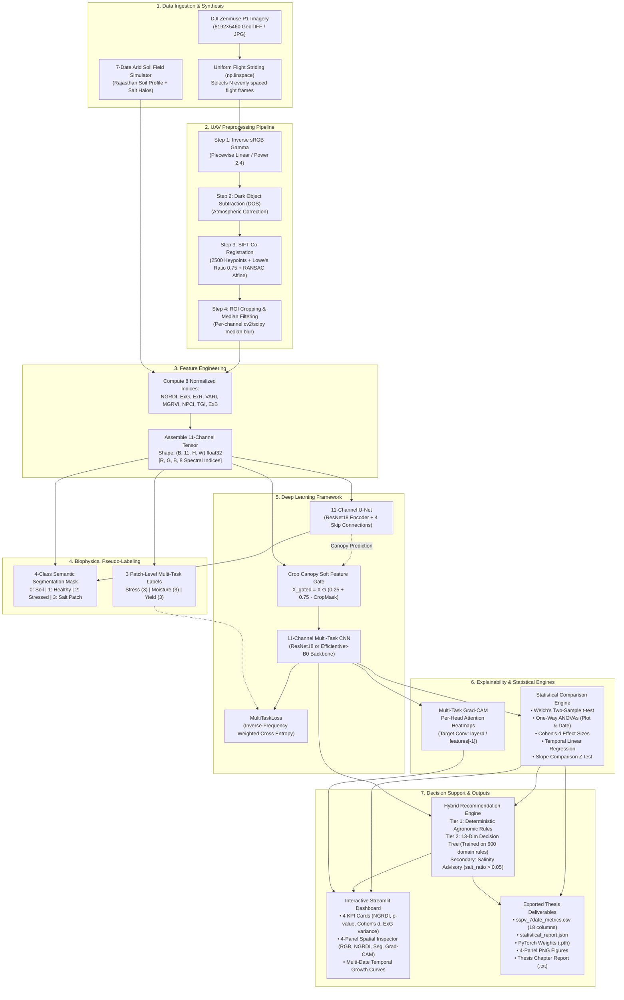
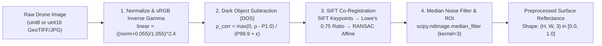
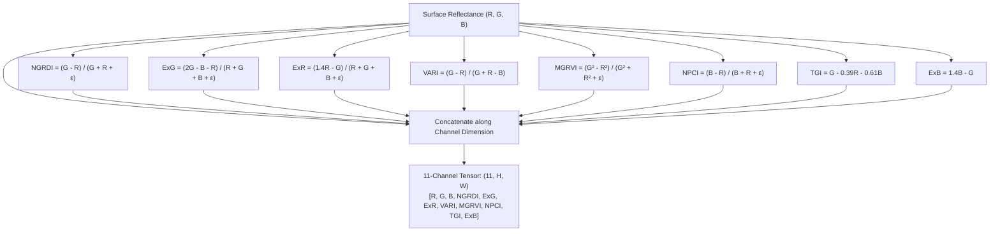
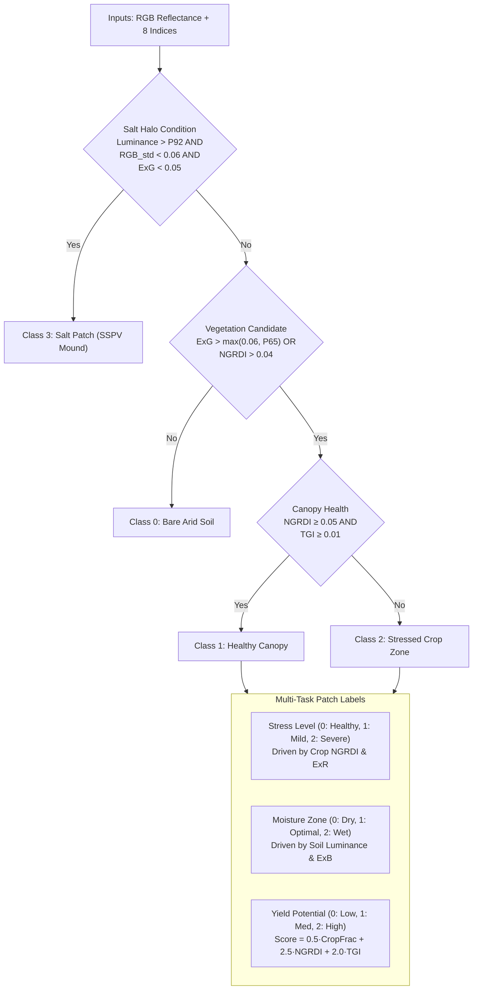
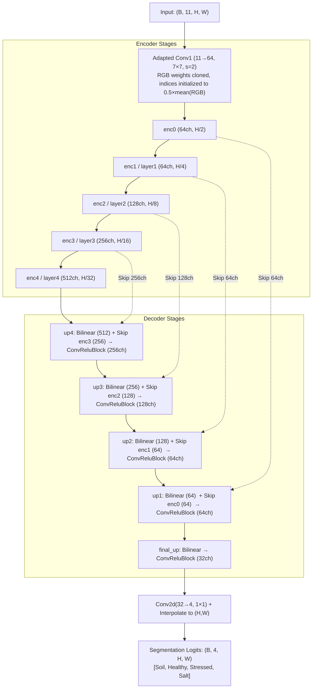
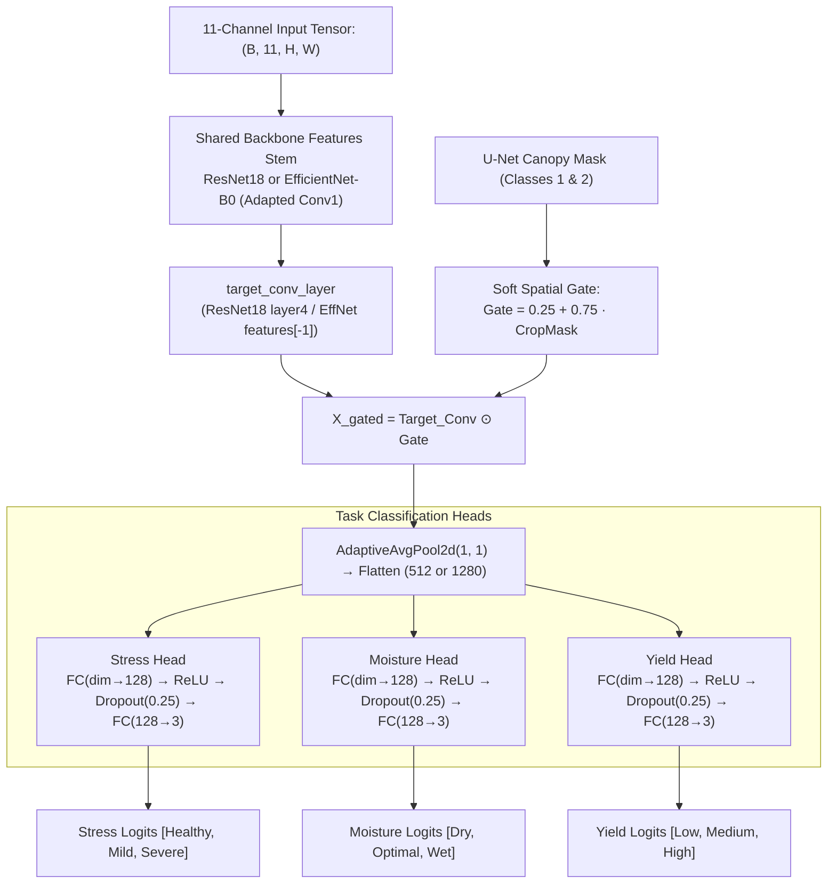
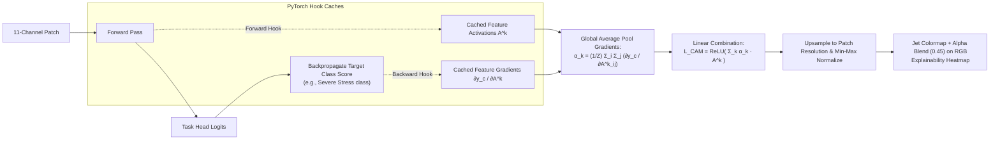
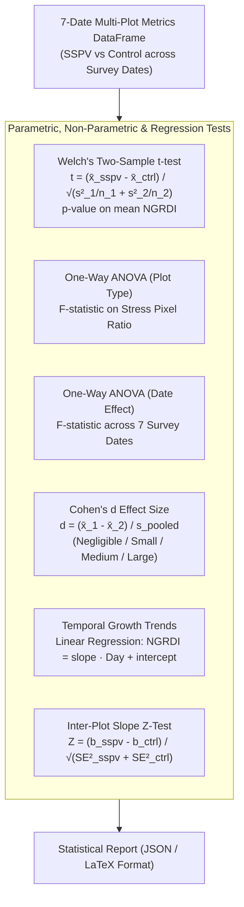
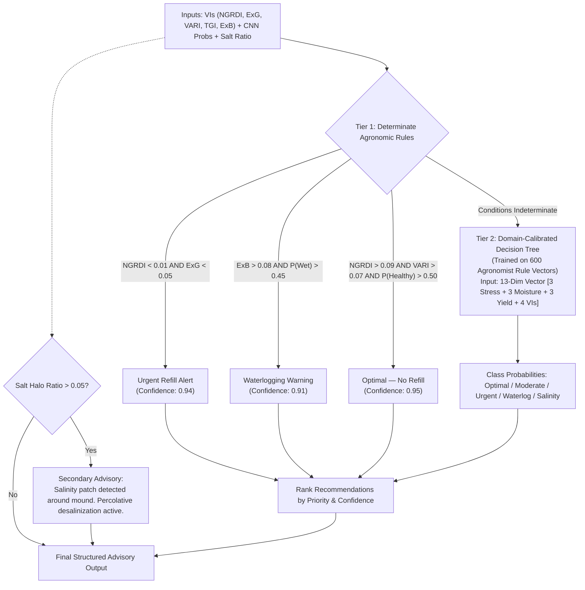
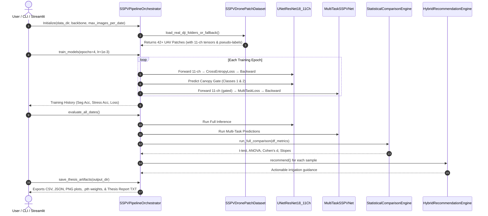

# 🏛️ SSPV Irrigation AI Evaluation — Architecture Diagrams Specification

**Project:** AI Based Evaluation of Empirical Subsurface Porous Vessel (SSPV) Irrigation System Performance Using Images  
**Student:** Subhranil Bala (Roll No.: M25AI2038) | **Supervisor:** Dr. Anand Krishnan Plappally  
**Institute:** Indian Institute of Technology Jodhpur (School of AI & Data Science)

---

## 1. End-to-End System Architecture

This diagram illustrates the complete dataflow from raw UAV imagery (or benchmark simulator) to final thesis artifacts and Streamlit dashboard.

> 📐 **High-Resolution Vector Architecture SVG:** [`Architectures/Complete End-to-End System Architecture.svg`](Architectures/Complete%20End-to-End%20System%20Architecture.svg)

---

## 2. Module-Wise Architecture Diagrams

### Module 1: Preprocessing Pipeline (`preprocessing.py`)

---

### Module 2: Feature Engineering (`feature_engineering.py`)

---

### Module 3: Biophysical Weakly-Supervised Pseudo-Labeling (`pseudo_labeling.py`)

---

### Module 4: Neural Architectures (`models.py`)

#### A. 11-Channel U-Net Field Segmentation (`UNetResNet18_11Ch`)

> 📐 **High-Resolution Vector Architecture SVG:** [`Architectures/11-Channel U-Net Field Segmentation.svg`](Architectures/11-Channel%20U-Net%20Field%20Segmentation.svg)

#### B. 11-Channel Multi-Task CNN (`MultiTaskSSPVNet`)

> 📐 **High-Resolution Vector Architecture SVG:** [`Architectures/11-Channel Multi-Task CNN with Crop Gating.svg`](Architectures/11-Channel%20Multi-Task%20CNN%20with%20Crop%20Gating.svg)

---

### Module 5: Explainability Engine (`explainability.py`)

---

### Module 6: Statistical Comparison Engine (`statistics_engine.py`)

---

### Module 7: Hybrid Recommendation Engine (`recommendation.py`)

> 📐 **High-Resolution Vector Architecture SVG:** [`Architectures/Hybrid Recommendation Engine Architecture.svg`](Architectures/Hybrid%20Recommendation%20Engine%20Architecture.svg)

---

### Module 8 & 9: Dataset Ingestion & Orchestration Lifecycle (`dataset.py` & `orchestrator.py`)

